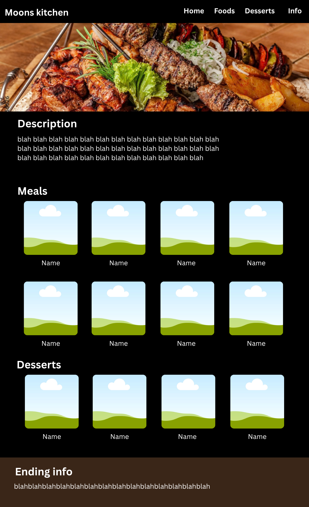
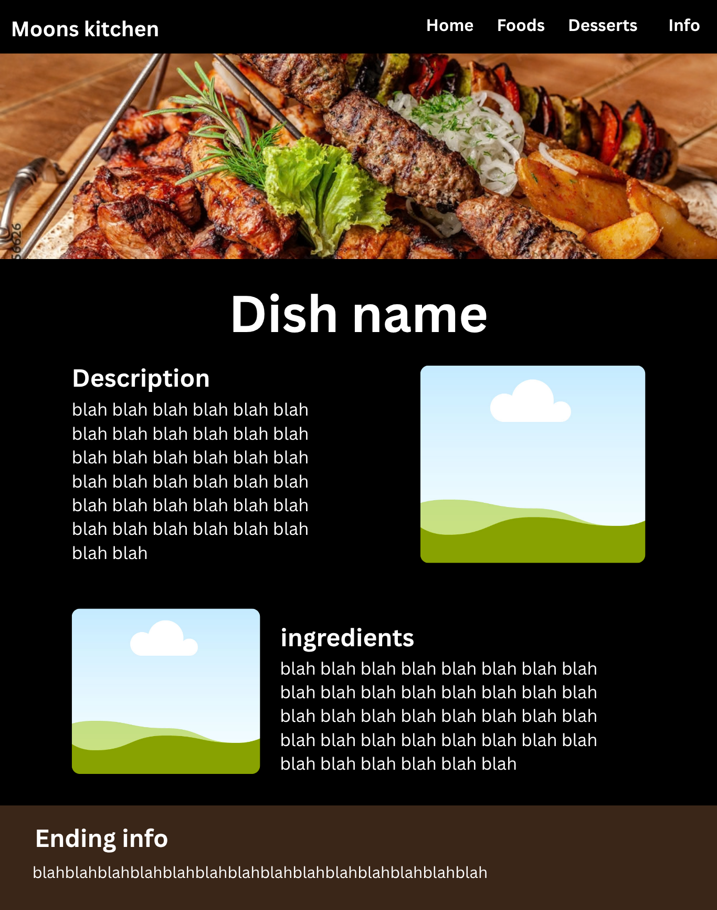

# [Aya's Kitchen]
## Om sidan
Sidan handlar om olika maträtter och efterrätter från Mellanöstern, med lite information, bilder och historik för varje rätt.
Sidan har även en checklista med alla ingredienser man behöver för rätten.
Webbplatsen är till för personer som är nyfikna på matkulturen i Mellanöstern.

## Skiss
Det slutgiltiga resultatet blev lite annorlunda än skissen. 
Till exempel lade jag till en checklista som inte fanns med i skissen, eftersom jag behövde lägga till en ny funktion på webbplatsen.

Jag ändrade även designen lite för att den skulle passa webbplatsens moderna utseende. 
Till exempel lade jag inte till de stora banners som fanns med i skissen på de inre sidorna.

 

## Funktionalitet
Besökaren kan navigera mellan webbplatsens olika sidor(genom en navigation bar också, när man klickar i nav baren så hoppar man ner till en section i sidan), läsa information och använda checklistan för att checka in vilka ingrediencer man har.
Webbplatsens HTML-filer sköter sidornas struktur och innehåll, CSS-filerna ansvarar för designen och JavaScript-filerna hanterar funktioner som checklistan och användarinteraktioner.

## AI-användning
exempel 1: 
Jag bad AI att generera texten och informationen om de olika rätten samt ingredients listorna. Den gav mig exact det jag ville.
Jag använde den genom att copiera in texten.

exempel 2:
Jag frågade AI om hur jag kan göra responsiv styling för olika delar av webbplatsen. 
Jag fick förslaget att använda @media. 
AI förklarade vad det gör, och jag tog till mig idén och använde den på min webbplats.

## Tekniska val (VG)
Vilka beslut tog jag, och varför?
Jag valde att göra webbplatsen enkel och modern så att den skulle vara lätt att använda. Jag lade till en checklista för att besökaren skulle kunna hålla koll på olika ingredienser. Jag använde också @media i CSS för att webbplatsen skulle fungera bra på både mobil och dator. Under arbetets gång ändrade jag några saker från min skiss för att designen skulle passa bättre ihop. 

## Bedömning av AI-innehåll (VG)
Jag testade förslagen från AI och kollade om de passade min webbplats. Jag använde idén med @media till exempel för att göra sidan responsiv, men ändrade koden lite så att den passade min design bättre. Jag behöll det som fungerade och ändrade det som inte passade så bra.